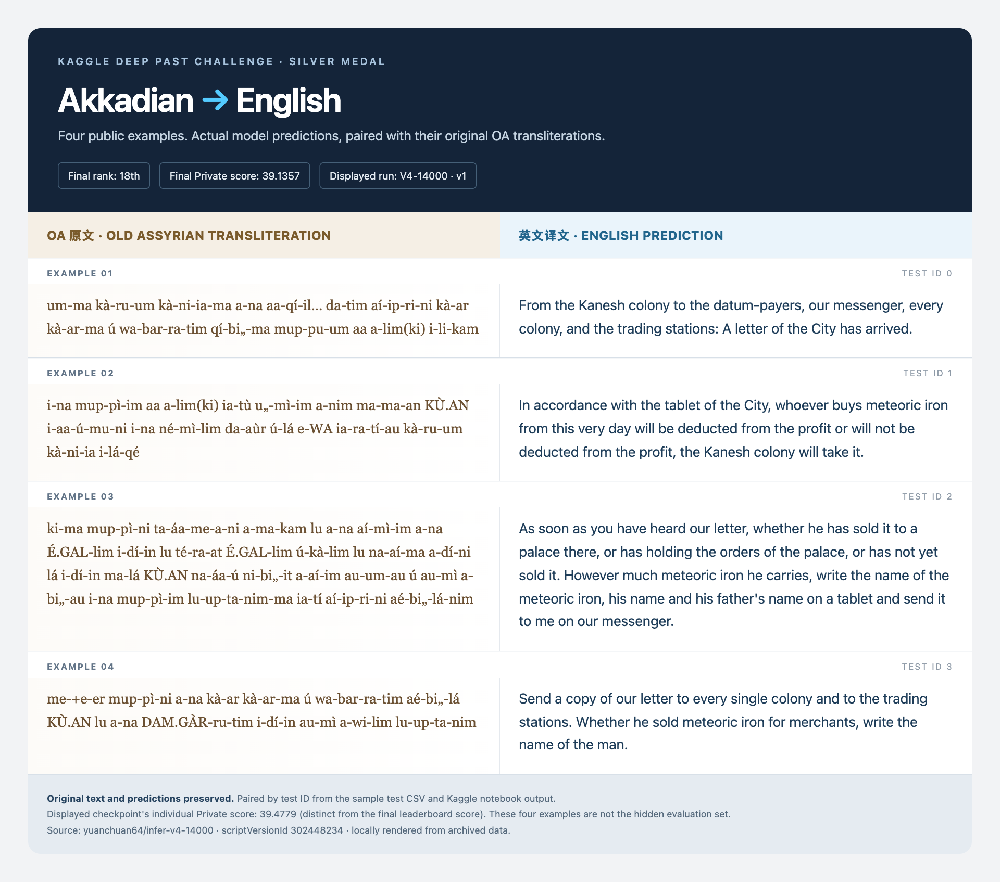

<div align="center">

# Kaggle Deep Past — 18th Place 🥈

### Akkadian → English · Open ByT5-XL Model

**Peak leaderboard: #3 · Final Private score: 39.1357**

[](https://huggingface.co/TaiE64/OA2Eng-ByT5XL-V4-14000)
[](https://www.kaggle.com/competitions/deep-past-initiative-machine-translation/leaderboard)

**[English](README.md) · [简体中文](README.zh-CN.md) · [Model](https://huggingface.co/TaiE64/OA2Eng-ByT5XL-V4-14000) · [Run the notebooks](submission/README.md)**

</div>

My silver-medal project for translating **Old Assyrian Akkadian transliterations into English**: public model weights, inference notebooks, and the data-processing work behind the competition.

## See the translations

**Left: original OA transliteration · Right: English prediction**



*Four public examples from `infer-v4-14000`, paired by ID with their original OA text. Predictions are unchanged. [Text version](media/evidence/v4-14000-parallel-preview.csv) · [Kaggle run](https://www.kaggle.com/code/yuanchuan64/infer-v4-14000?scriptVersionId=302448234) · [Score provenance](media/evidence/provenance.json).*

The displayed run achieved **39.4779 Private**—the best individual submission in the account. The **final leaderboard result is 18th / 39.1357**; these are different records.

## Get the model

**[🤗 TaiE64/OA2Eng-ByT5XL-V4-14000](https://huggingface.co/TaiE64/OA2Eng-ByT5XL-V4-14000)** · ~3.74B parameters · BF16 · ~7.5 GB · Public download

```bash
pip install huggingface_hub
hf download TaiE64/OA2Eng-ByT5XL-V4-14000 --local-dir ./models/OA2Eng-ByT5XL-V4-14000
```

Set the notebook's `UltraConfig.model_path` to your model directory. For Kaggle, attach the downloaded model as a dataset and use its mounted path. [Setup and version details →](submission/README.md)

## Behind the result

- **Data curation:** extract parallel text from scholarly PDFs, filter noisy pairs, and deduplicate sources.
- **Akkadian normalization:** handle gaps, determinatives, diacritics, subscripts, and fractions.
- **ByT5 inference:** beam search, length-bucket batching, and translation postprocessing.

## Explore

| Resource | Contents |
|---|---|
| [Inference notebooks](submission/README.md) | Kaggle setup, checkpoint paths, and runtime details |
| [Data-format notes](data_format_rules.md) | Competition-specific text normalization and alignment |
| [PDF extraction](data/03_new_extracted/) | AKT extraction scripts and parallel-text exports |
| [Training notes](params.md) | Recorded hyperparameters and inference defaults |

Special thanks to **Ivan C**, the Deep Past Initiative, and the model and data contributors.

**If this helps your low-resource NLP work, give it a ⭐ and share what you build.**
