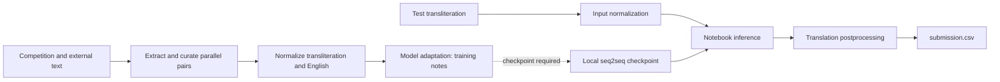

<div align="center">

# Deep Past Challenge · Akkadian → English

### Translating 4,000-year-old records with modern language models.

**🥈 Final leaderboard: 18th · Highest leaderboard position: 3rd**

[](https://www.kaggle.com/competitions/deep-past-initiative-machine-translation/leaderboard)
[](https://www.kaggle.com/competitions/deep-past-initiative-machine-translation/leaderboard)
[](#the-challenge)

**[English](README.md) · [简体中文](README.zh-CN.md)**

[🤗 Model weights](https://huggingface.co/TaiE64/OA2Eng-ByT5XL-V4-14000) · [Best-scoring output](#best-scoring-notebook-output) · [Competition](https://www.kaggle.com/competitions/deep-past-initiative-machine-translation) · [Inference notebooks](submission/README.md) · [Data-format notes](data_format_rules.md) · [Configuration notes](params.md)

</div>

My competition archive for Kaggle's **Deep Past Challenge — Translate Akkadian to English**, covering Old Assyrian transliteration, data preparation, and notebook inference. The result: **18th place and a silver medal**, with a highest leaderboard position of **3rd**, as recorded in the original project README.

The useful work here goes beyond a model call: extracting parallel text from scholarly publications, handling damaged-text markers and unusual characters, reconciling document-level data with sentence-level evaluation, and producing translations in an offline Kaggle runtime.

## At a glance

| Result / artifact | Details |
|---|---|
| Final leaderboard | **18th · Silver medal** |
| Highest leaderboard position | **3rd** |
| Task | Old Assyrian Akkadian transliteration → English |
| Model entry point | ByT5-XL checkpoint inference notebook, plus a backup notebook |
| Data work | PDF extraction, text normalization, filtering, deduplication, and sentence-level resources |
| Evaluation | Corpus-level geometric mean of BLEU and chrF++ |

The rank and medal are the author's recorded competition results. The submission scores and notebook links below were checked through the authenticated Kaggle API; a highest score across submissions does not by itself establish which submission was selected for the final leaderboard.

## Best-scoring notebook output

The authenticated Kaggle API returned **107 submissions** for this competition. Their highest Public and Private scores come from different submissions:

| Selection | Notebook | Public score | Private score |
|---|---|---:|---:|
| **Highest Private score** | [infer-v4-14000](https://www.kaggle.com/code/yuanchuan64/infer-v4-14000?scriptVersionId=302448234) | 36.9959 | **39.4779** |
| Highest Public score | [akkadian-baseline-ref](https://www.kaggle.com/code/yuanchuan64/akkadian-baseline-ref?scriptVersionId=302745772) | **38.5569** | 39.1302 |


*Original Kaggle execution output and predictions, rendered locally for readability. The four examples are from the notebook's public example run, not the hidden evaluation set. Notebook links may require access because the originals are private. [Output CSV](media/evidence/v4-14000-preview.csv) · [Log excerpt](media/evidence/v4-14000-output.txt) · [Score and version provenance](media/evidence/provenance.json).*

## Download the checkpoint

**[🤗 TaiE64/OA2Eng-ByT5XL-V4-14000](https://huggingface.co/TaiE64/OA2Eng-ByT5XL-V4-14000)** is publicly available without gated access. It contains approximately **3.74B parameters**, BF16 safetensors weights, and model/tokenizer configuration files; the download is approximately **7.5 GB**.

```bash
python -m pip install huggingface_hub
hf download TaiE64/OA2Eng-ByT5XL-V4-14000 \
  --revision f328700ddf5095623bb5903105e41b4b8d36da3f \
  --local-dir ./models/OA2Eng-ByT5XL-V4-14000
```

Point `UltraConfig.model_path` at the downloaded folder, or attach it as a Kaggle model dataset for offline inference. This owner-provided V4-14000 release matches the version naming of the highest-Private-score notebook's `akkadian-v4-14000` dataset; binary equality between those artifacts has not been checked. It is a separate checkpoint from the archived `fft5400` notebook's default. See the [setup guide](submission/README.md#public-hugging-face-checkpoint).

## The challenge

The inputs are **Latin-script transliterations of cuneiform texts**, not tablet photographs. They contain syllable separators, diacritics, logograms, determinatives, missing signs, names, quantities, and units. Small formatting differences can therefore matter throughout the translation pipeline.

There is also a granularity mismatch: the competition's original parallel training data is document-aligned, while evaluation uses sentence-level translations. The [data-format notes](data_format_rules.md) document the alignment problem and the competition-era formatting updates.

The official evaluation aggregates across the corpus:

```text
score = sqrt(BLEU × chrF++)
```

See the [competition evaluation](https://www.kaggle.com/competitions/deep-past-initiative-machine-translation/overview) for the scoring definition. The optional sentence-level similarity used by the notebook's MBR selector serves a different purpose.

## What you can explore

- **ByT5-XL checkpoint inference.** The [`fft5400` notebook](submission/fft5400/akkadian-fft5400.ipynb) loads a local sequence-to-sequence checkpoint and generates English translations with beam search.
- **Domain-specific normalization.** Input processing handles gap markers, determinatives, subscript digits, character variants, floating-point artifacts, and Unicode fractions.
- **Data extraction from publications.** AKT extraction scripts account for page columns, line numbers, font-encoded diacritics, and superscripts/subscripts when assembling parallel text.
- **Corpus cleanup.** Helpers inspect overlap and filter empty pairs, abnormal source/target length ratios, duplicate sources, and copy errors.
- **Inference controls.** Length-bucket batching, configurable generation limits, periodic output checkpoints, and translation postprocessing are implemented in the notebooks.
- **An optional MBR path.** Candidate generation and a chrF++-style consensus selector are included for experimentation. **MBR is disabled in the checked-in defaults**; no final-score gain is claimed for it.

## Pipeline overview



The data helpers and inference notebooks are available here. Training is represented by [notes](params.md); the full trainer is not included, and model weights are published separately on [Hugging Face](https://huggingface.co/TaiE64/OA2Eng-ByT5XL-V4-14000).

## Start here

| If you want to… | Open |
|---|---|
| Inspect the inference implementation | [`akkadian-fft5400.ipynb`](submission/fft5400/akkadian-fft5400.ipynb) |
| Set up a Kaggle run | [Notebook setup guide](submission/README.md) |
| Compare the backup preprocessing path | [`akkadian-baseline-ref.ipynb`](submission/BackUp_Submission/akkadian-baseline-ref.ipynb) |
| Understand the text-format pitfalls | [Data-format rules](data_format_rules.md) |
| Read the PDF extraction logic | [`extract_akt6.py`](data/03_new_extracted/extract_akt6.py), [`extract_akt8.py`](data/03_new_extracted/extract_akt8.py) |
| Inspect corpus cleaning | [`deep_clean_all.py`](data/01_safe_training/scripts/deep_clean_all.py), [`clean_akt.py`](data/03_new_extracted/clean_akt.py) |
| Check recorded hyperparameters and notebook defaults | [Configuration notes](params.md) |

To browse locally:

```bash
git clone https://github.com/TaiE64/KaggleDeepPast-Challenge-Akkadian2English-LB18th.git
cd KaggleDeepPast-Challenge-Akkadian2English-LB18th
```

For inference, upload a notebook to Kaggle, attach the competition data and the matching model dataset, and review `UltraConfig` before running. The [setup guide](submission/README.md) lists the dataset identifiers and expected outputs.

## Repository map

```text
submission/
  fft5400/                  ByT5-XL checkpoint inference notebook + Kaggle metadata
  BackUp_Submission/        Backup notebook, saved settings, and example predictions
  *_wheel*/                 Archived offline dependency assets
data/
  competition/              Competition tables and reference metadata
  01_safe_training/         Curated tables, backups, generated data, cleaning helpers
  03_new_extracted/         AKT extraction / cleanup scripts and exported pairs
  03_auxiliary/             Auxiliary reference material
  04_reference/             Publication and grammar resources (many LFS pointers)
  external/leiwong/         Extended corpus and dictionary with their own README
PdfExtraction/              AKT extraction CSV exports
data_format_rules.md        Detailed competition-era format and data notes
params.md                   Recorded training notes and current inference defaults
```

The checked-in `merged_all.csv` contains **69,211 rows**. That is the size of this archived table, not a claim that every row was used in the final training run. Likewise, extraction CSVs represent intermediate versions and should not be added together as a unique corpus total.

## Reproduction notes

- **Download the released weights.** The [V4-14000 checkpoint](https://huggingface.co/TaiE64/OA2Eng-ByT5XL-V4-14000) is public on Hugging Face. Other archived notebooks target different Kaggle datasets; check the model path before running.
- **Read source, not just saved output.** The notebooks retain older execution logs, including paths/settings that differ from the current source. Run a fresh session to obtain current results.
- **Check large-file contents.** Several PDFs and large CSVs are Git LFS pointer files in a fresh checkout; resolve the assets before using extraction scripts. The published notebook can be inspected without those PDFs.
- **Review helper paths.** Some data-cleaning scripts retain original Windows paths and write CSVs in place. Adapt the paths and work on a copy when exploring them.

## Acknowledgements

Special thanks to **Ivan C**, acknowledged in the original project README. Thanks also to the Deep Past Initiative and Kaggle organizers, the scholars behind the source texts and translations, and the model and data contributors whose work supports this archive.

Third-party datasets, publications, models, and dependency assets retain their own terms and attribution. No repository-wide code license is currently specified.

If the notebooks or data-processing notes help your work on low-resource translation, **a star is appreciated**. Reproducible issues and improvements to the documentation, preprocessing, or setup are welcome.
