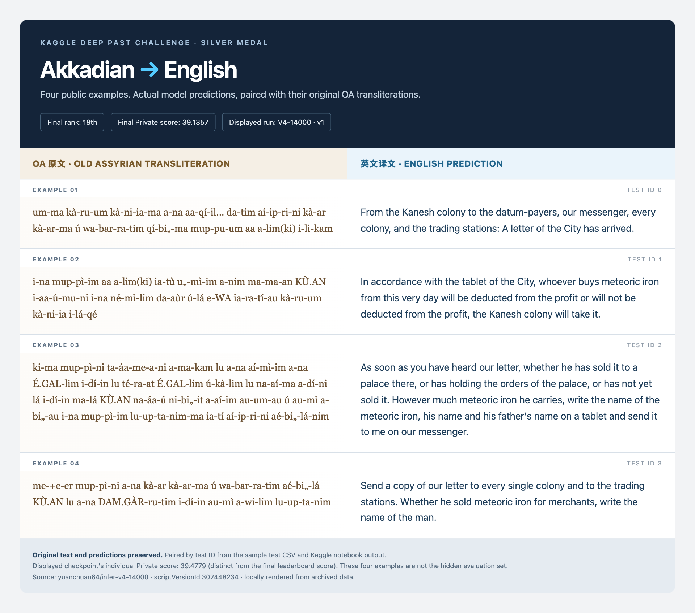

<div align="center">

# Kaggle Deep Past Challenge：阿卡德语 → 英语

### 🥈 第 18 名 · 银牌 · 开放 ByT5-XL 模型权重

**最高榜位：第 3 名 · 最终 Private 分：39.1357**

[](https://huggingface.co/TaiE64/OA2Eng-ByT5XL-V4-14000)
[](https://www.kaggle.com/competitions/deep-past-initiative-machine-translation/leaderboard)

**[English](README.md) · 简体中文 · [下载模型](https://huggingface.co/TaiE64/OA2Eng-ByT5XL-V4-14000) · [运行指南](submission/README.md)**

</div>

我的 Kaggle 银牌项目：把**古亚述阿卡德语转写文本翻译成英语**。这里分享模型权重、推理 notebook，以及比赛中的数据处理经验。

## 直接看翻译效果

**左栏：OA 原文（拉丁字母转写）｜右栏：模型英文译文**



*四条公开样例，按 ID 对齐 OA 原文与 `infer-v4-14000` 的真实输出，译文未改写。[文字版](media/evidence/v4-14000-parallel-preview.csv) · [Kaggle 运行版本](https://www.kaggle.com/code/yuanchuan64/infer-v4-14000?scriptVersionId=302448234) · [成绩记录](media/evidence/provenance.json)。*

展示版本的单次 **Private 分为 39.4779**，是账号所有提交中的最高值；**最终榜单成绩为第 18 名 / 39.1357**，两者分开标注。

## 下载模型

**[🤗 TaiE64/OA2Eng-ByT5XL-V4-14000](https://huggingface.co/TaiE64/OA2Eng-ByT5XL-V4-14000)** · 约 3.74B 参数 · BF16 · 约 7.5 GB · 公开下载

```bash
pip install huggingface_hub
hf download TaiE64/OA2Eng-ByT5XL-V4-14000 --local-dir ./models/OA2Eng-ByT5XL-V4-14000
```

将 notebook 的 `UltraConfig.model_path` 指向模型目录；在 Kaggle 上运行时，把模型挂载为数据集并填写对应路径。[详细运行说明 →](submission/README.md)

## 方案亮点

- **数据整理：** 从学术 PDF 提取对译，过滤噪声并去重。
- **转写规范化：** 处理残缺标记、限定词、变音符号、下标与分数。
- **ByT5 推理：** Beam search、按长度分桶，以及译文后处理。

## 继续探索

| 入口 | 内容 |
|---|---|
| [推理 notebook](submission/README.md) | Kaggle 运行方法、模型路径与版本说明 |
| [数据格式笔记](data_format_rules.md) | 文本规范化与对齐中的问题 |
| [PDF 提取](data/03_new_extracted/) | AKT 提取脚本与对译导出 |
| [参数记录](params.md) | 训练笔记与推理配置 |

特别感谢 **Ivan C**、Deep Past Initiative，以及相关模型和数据的贡献者。

**如果对你的低资源 NLP 研究有帮助，欢迎点个 ⭐，也欢迎交流复现与改进。**
