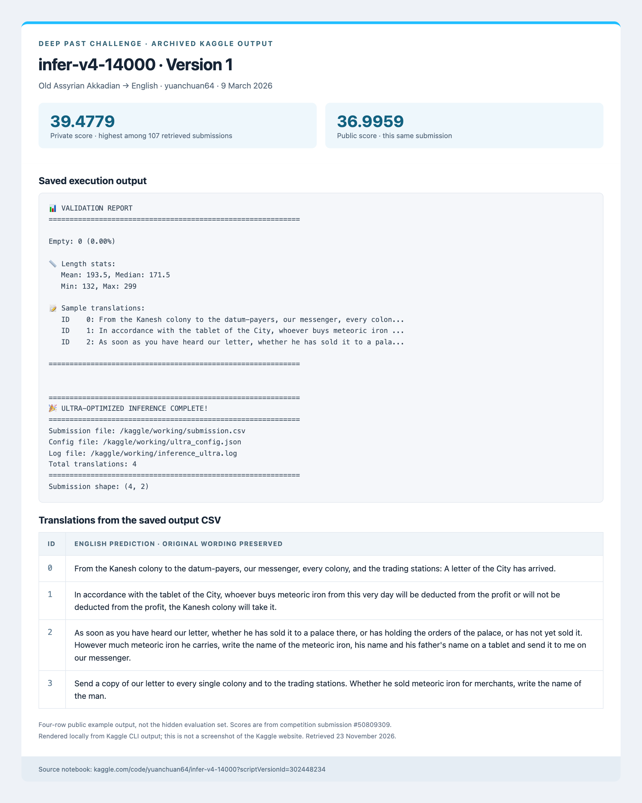

<div align="center">

# Deep Past Challenge · 阿卡德语 → 英语

### 用现代语言模型，读懂四千年前的商业文书。

**🥈 最终第 18 名 · 银牌 · 最高冲到第 3 名**

[](https://www.kaggle.com/competitions/deep-past-initiative-machine-translation/leaderboard)
[](https://www.kaggle.com/competitions/deep-past-initiative-machine-translation/leaderboard)

[English](README.md) · **简体中文** · [🤗 模型权重](https://huggingface.co/TaiE64/OA2Eng-ByT5XL-V4-14000) · [比赛主页](https://www.kaggle.com/competitions/deep-past-initiative-machine-translation) · [推理运行指南](submission/README.md)

</div>

这是我参加 Kaggle **Deep Past Challenge — Translate Akkadian to English** 的项目归档。比赛要求将古亚述阿卡德语的转写文本翻译成英语；我最终取得 **第 18 名、银牌**，比赛期间最高到过 **第 3 名**。

仓库保留了围绕这项任务做的数据与推理工作：**从学术文献提取平行语料、清洗和统一文本格式，再用序列到序列模型生成英文译文**。除了成绩，也希望这些处理低资源语言数据的经验能被更多人复用。

## 项目看点

| 方面 | 内容 |
|---|---|
| 比赛成绩 | 最终 **18th / Silver**，最高榜位 **3rd** |
| 模型入口 | ByT5-XL checkpoint 推理 notebook，以及备用 notebook |
| 数据工程 | PDF 对译提取、字符与残缺标记规范化、过滤、去重、句子级资源 |
| 推理实现 | Beam search、按长度分桶、生成参数控制、结果检查与后处理 |
| 可选实验 | 基于 chrF++ 风格相似度的 MBR 候选选择；当前默认关闭 |
| 评估指标 | 语料级 BLEU 与 chrF++ 的几何平均 |

排名与奖牌沿用作者记录；下方分数和 notebook 版本已通过登录后的 Kaggle API 核对。所有提交中的最高分，不等同于确认该条提交被选入最终榜单。

## 最高分 notebook 的真实输出

已核对本场比赛的 **107 条提交**。Public 与 Private 最高分来自不同提交：

| 记录 | Notebook | Public | Private |
|---|---|---:|---:|
| **Private 最高分** | [infer-v4-14000](https://www.kaggle.com/code/yuanchuan64/infer-v4-14000?scriptVersionId=302448234) | 36.9959 | **39.4779** |
| Public 最高分 | [akkadian-baseline-ref](https://www.kaggle.com/code/yuanchuan64/akkadian-baseline-ref?scriptVersionId=302745772) | **38.5569** | 39.1302 |



*图中内容取自 Kaggle 保存的原始日志和预测 CSV，在本地排版渲染；不是 Kaggle 网页截图。展示的是 4 条公开样例，非隐藏评估集。原 notebook 为私有，访问链接可能需要权限。[原始预测 CSV](media/evidence/v4-14000-preview.csv) · [日志片段](media/evidence/v4-14000-output.txt) · [分数与版本记录](media/evidence/provenance.json)。*

## 下载公开模型

**[🤗 TaiE64/OA2Eng-ByT5XL-V4-14000](https://huggingface.co/TaiE64/OA2Eng-ByT5XL-V4-14000)** 已公开，无需申请访问。仓库包含约 **3.74B 参数**的 BF16 safetensors 权重以及模型、tokenizer 配置，下载约 **7.5 GB**。

```bash
python -m pip install huggingface_hub
hf download TaiE64/OA2Eng-ByT5XL-V4-14000 \
  --revision f328700ddf5095623bb5903105e41b4b8d36da3f \
  --local-dir ./models/OA2Eng-ByT5XL-V4-14000
```

将 notebook 的 `UltraConfig.model_path` 指向下载目录，或把模型挂载为 Kaggle 数据集后离线推理。HF 发布版本与最高 Private 分 notebook 使用的数据集名称均为 V4-14000，但未做二进制一致性校验；它与归档中 `fft5400` 的默认 checkpoint 是不同版本。

## 这道题难在哪里？

**输入是楔形文字的拉丁字母转写，不是泥板照片。** 文本里包含音节分隔符、变音符号、苏美尔语词符、限定词、残缺标记、人名，以及各种数量和单位。格式处理会贯穿数据准备、模型输入和输出后处理。

另一个关键问题是粒度不一致：原始训练对译按文档对齐，评估则使用句子级翻译。完整的数据格式变化和处理记录见 [data_format_rules.md](data_format_rules.md)。

比赛按整个语料计算：

```text
score = sqrt(BLEU × chrF++)
```

指标定义见 [Kaggle 官方说明](https://www.kaggle.com/competitions/deep-past-initiative-machine-translation/overview)。Notebook 的可选 MBR 路径使用句子级候选相似度，两者用途不同。

## 仓库中可以直接研究什么？

- **推理代码：** [fft5400 notebook](submission/fft5400/akkadian-fft5400.ipynb) 从本地加载模型与 tokenizer，执行 beam search 并输出英文译文。
- **转写规范化：** 统一 `<gap>`、限定词、Unicode 下标、字符变体、浮点数伪影和分数格式。
- **PDF 提取：** [AKT 6 提取脚本](data/03_new_extracted/extract_akt6.py) 处理双栏版面、行号、字体编码的变音符号及上下标；[AKT 8 脚本](data/03_new_extracted/extract_akt8.py) 提供另一组出版物提取逻辑。
- **语料清洗：** 检查空对译、异常长度比例、重复源文本和源目标相同的复制错误。
- **候选选择实验：** 代码保留 MBR 分支，但当前默认 `use_mbr=False`，不把它描述为最终成绩的已验证增益。

## 如何开始

```bash
git clone https://github.com/TaiE64/KaggleDeepPast-Challenge-Akkadian2English-LB18th.git
cd KaggleDeepPast-Challenge-Akkadian2English-LB18th
```

1. 先读 [推理运行指南](submission/README.md)，选择 notebook。
2. 在 Kaggle 准备比赛数据与对应 checkpoint，检查 `UltraConfig` 中的路径。
3. 运行新会话，检查生成的 `submission.csv`、配置和日志。
4. 想理解数据侧处理，接着看 [格式规则](data_format_rules.md) 与 [参数记录](params.md)。

模型权重已单独发布在 [Hugging Face](https://huggingface.co/TaiE64/OA2Eng-ByT5XL-V4-14000)；Git 仓库未包含完整训练程序，训练部分目前保留的是参数笔记。当前归档适合阅读、分析和适配，完整复现最终成绩还需要匹配的训练与提交资产。

## 目录导航

| 路径 | 内容 |
|---|---|
| [submission/fft5400/](submission/fft5400/) | ByT5-XL checkpoint 推理 notebook 与 Kaggle 元数据 |
| [submission/BackUp_Submission/](submission/BackUp_Submission/) | 备用 notebook、保存的配置和示例预测 |
| [data/01_safe_training/](data/01_safe_training/) | 整理后的数据表、备份、生成数据及清洗脚本 |
| [data/03_new_extracted/](data/03_new_extracted/) | AKT 提取、清洗脚本与导出结果 |
| [PdfExtraction/](PdfExtraction/) | AKT 对译 CSV 导出 |
| [data/competition/](data/competition/) | 比赛数据表和参考元数据 |
| [data/04_reference/](data/04_reference/) | 出版物和语法资源，许多文件为 LFS 指针 |
| [data/external/leiwong/](data/external/leiwong/) | 附带独立说明的扩展语料与词典 |

当前 `merged_all.csv` 实测包含 **69,211 行**，这是该归档表的行数，不代表最终训练使用了全部记录。不同提取版本之间可能有重叠，不能直接相加当成唯一语料总量。

运行前注意三点：notebook 的旧输出可能与现有源码不同；部分大文件需要先获取实际内容；一些数据脚本仍保留原 Windows 路径并原地写回 CSV，探索时应使用副本。

## 致谢

特别感谢原 README 中致谢的 **Ivan C**。也感谢 Deep Past Initiative、Kaggle、原始文献与翻译的学者，以及相关模型和数据的贡献者。

第三方数据、出版物、模型和依赖资产保留各自许可与署名要求；仓库目前未指定统一的代码许可证。

如果这些代码和记录对你的低资源机器翻译研究有帮助，欢迎 **Star**，也欢迎交流数据处理、推理复现和古语言翻译中的问题。
